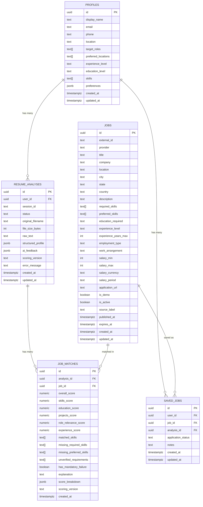

# Database – AI Resume Analyzer & Job Matcher

This directory contains all Supabase PostgreSQL migrations, seed data, and operational notes for the project.

> [!IMPORTANT]
> Always run migrations **in numbered order**. Never skip a migration or run seeds before the schema is applied.

---

## Directory Structure

```
database/
├── migrations/
│   ├── 001_initial_schema.sql       # All tables, indexes, triggers, FK constraints
│   ├── 002_rls_policies.sql         # Row Level Security policies + permission grants
│   └── 003_runtime_columns.sql      # Runtime columns (role_category, word_count, warnings)
└── seeds/
    └── 001_jobs_seed.sql            # 60 demo job listings (Indian market, entry-level)
```

---

## Schema Overview



---

## Quick Setup (Supabase Dashboard)

### Step 1 – Apply Schema

1. Open your Supabase project → **SQL Editor**
2. Paste and run [`migrations/001_initial_schema.sql`](migrations/001_initial_schema.sql)
3. Verify: you should see 5 new tables in the Table Editor

### Step 2 – Apply RLS Policies

1. Paste and run [`migrations/002_rls_policies.sql`](migrations/002_rls_policies.sql)
2. Verify: Tables → each table → **RLS** shows as **Enabled**

### Step 3 – Load Seed Data

1. Paste and run [`seeds/001_jobs_seed.sql`](seeds/001_jobs_seed.sql)
2. Verify: `SELECT COUNT(*) FROM public.jobs WHERE is_demo = true;` → should return **60**

---

## Using the Supabase CLI

```bash
# Apply all migrations
supabase db push

# Or run individually
psql "$DATABASE_URL" -f database/migrations/001_initial_schema.sql
psql "$DATABASE_URL" -f database/migrations/002_rls_policies.sql
psql "$DATABASE_URL" -f database/seeds/001_jobs_seed.sql
```

---

## RLS Policy Summary

| Table | anon | authenticated (own rows) | service_role |
|-------|------|--------------------------|--------------|
| `profiles` | ✗ | Full CRUD | Bypass |
| `jobs` | SELECT (active) | SELECT (active) | Full CRUD |
| `resume_analyses` | ✗ | Full CRUD (own) | Bypass |
| `job_matches` | ✗ | SELECT (own analyses) | Bypass |
| `saved_jobs` | ✗ | Full CRUD (own) | Bypass |

> [!NOTE]
> **Guest resume analyses** (where `user_id` is NULL and `session_id` is set) must be written
> server-side using the `service_role` key. The RLS policy for `resume_analyses` requires
> `auth.uid() = user_id`, which evaluates to false for anonymous sessions.

---

## Key Design Decisions

### Auto-Profile Creation
A `AFTER INSERT ON auth.users` trigger automatically creates a `profiles` row when a new user signs up, populating `id`, `email`, and `display_name` from the auth metadata.

### Guest Support
`resume_analyses` allows a nullable `user_id` paired with a `session_id` string, enabling unauthenticated (guest) users to upload resumes. A `CHECK` constraint enforces that at least one of the two is populated.

### Scoring Versioning
Both `resume_analyses` and `job_matches` carry a `scoring_version` column (default `'v1'`). When the AI scoring algorithm changes, increment this version to allow historical comparisons and cache invalidation.

### Demo Data Safety
All seed records carry `is_demo = TRUE` and `source_label = 'Demo Data'`. Company names include the `[DEMO]` suffix. The application UI should render a visible badge for demo listings.

---

## Seed Data Coverage

| Category | Count | Cities Covered |
|----------|-------|----------------|
| Digital Marketing / Marketing Executive | 10 | Bangalore, Mumbai, Hyderabad, Pune, Delhi, Chennai, Kolkata, Gurgaon, Noida |
| Business Development Executive (BDE) | 10 | Mumbai, Bangalore, Hyderabad, Delhi, Pune, Chennai, Nashik |
| Sales Trainee | 8 | Bangalore, Delhi, Pune, Mumbai, Hyderabad, Chennai, Kolkata |
| HR Recruiter / HR Trainee | 8 | Delhi, Mumbai, Pune, Bangalore, Hyderabad, Chennai, Gurgaon, Kolkata |
| Business Analyst Trainee | 8 | Bangalore, Hyderabad, Pune, Mumbai, Delhi |
| Operations Executive | 8 | Mumbai, Bangalore, Delhi, Pune, Gurgaon, Chennai, Kolkata |
| Customer Support Executive | 8 | Hyderabad, Bangalore, Mumbai, Delhi, Chennai, Pune |
| **Total** | **60** | |

---

## Environment Variables Required

```env
# Supabase project URL and keys (add to .env.local)
NEXT_PUBLIC_SUPABASE_URL=https://your-project-ref.supabase.co
NEXT_PUBLIC_SUPABASE_ANON_KEY=your-anon-key
SUPABASE_SERVICE_ROLE_KEY=your-service-role-key   # server-side only, never expose
```

> [!CAUTION]
> **Never** expose `SUPABASE_SERVICE_ROLE_KEY` to the browser or commit it to version control.
> It bypasses all RLS policies and has full database access.

---

## Useful Queries

```sql
-- Count jobs per category
SELECT title, COUNT(*) 
FROM public.jobs 
WHERE is_demo = true 
GROUP BY title 
ORDER BY COUNT(*) DESC;

-- Jobs by city
SELECT city, COUNT(*) 
FROM public.jobs 
WHERE is_active = true 
GROUP BY city 
ORDER BY COUNT(*) DESC;

-- Top matches for a given analysis
SELECT j.title, j.company, jm.overall_score
FROM public.job_matches jm
JOIN public.jobs j ON j.id = jm.job_id
WHERE jm.analysis_id = '<your-analysis-uuid>'
ORDER BY jm.overall_score DESC
LIMIT 10;

-- User's saved jobs pipeline
SELECT j.title, j.company, sj.application_status, sj.notes
FROM public.saved_jobs sj
JOIN public.jobs j ON j.id = sj.job_id
WHERE sj.user_id = auth.uid()
ORDER BY sj.updated_at DESC;
```
